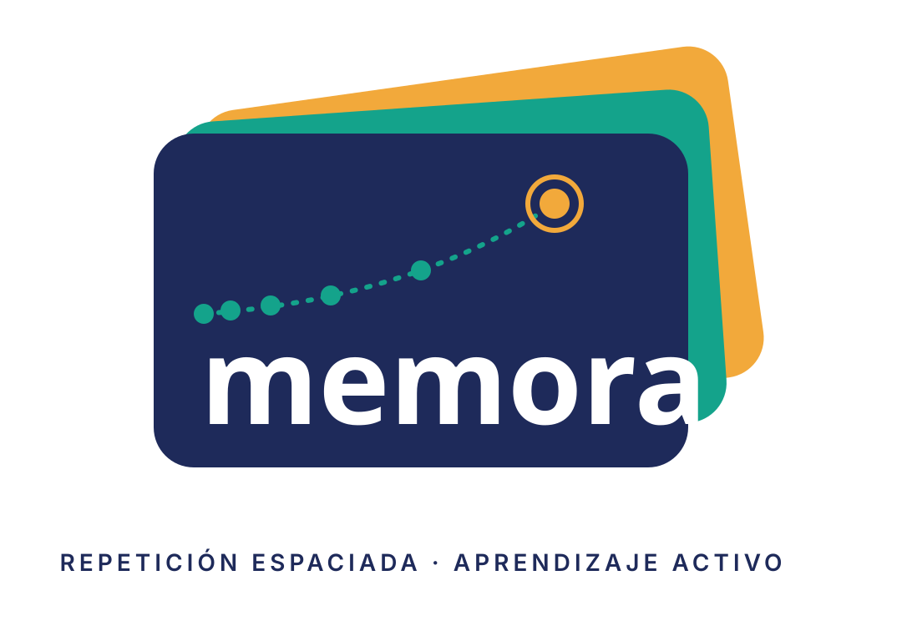

<p align="center">
  
</p>

# Memora

Aplicación móvil de tarjetas de memoria con repetición espaciada para estudiantes universitarios. Proyecto del
Grupo 8 de Sistemas de Información III, Universidad Nacional Experimental de los Llanos Centrales «Rómulo Gallegos».

El servidor está en [memora-api](https://github.com/notNakura/memora-api).

## Qué hace

- Registro en tres pasos con verificación del correo por código e inicio de sesión.
- Varias instituciones por persona: unirse a una sección o institución con un código, registrar una institución
  y elegir la institución activa.
- Navegación según el rol: estudiante, profesor, administrador de la institución y administrador de área.
- Panel docente: secciones, solicitudes de ingreso, invitación con código y QR, desempeño de cada estudiante.
- Administración: áreas, usuarios, carga de la lista de inscritos (CSV), moderación y bitácora.
- Gestión académica: lapsos, materias, unidades y secciones.
- Funciona sin conexión: copia local en SQLite que se sincroniza con el servidor.

En desarrollo: repaso diario con FSRS, mazos y tarjetas, evaluaciones, avisos y progreso.

## Tecnologías

Expo SDK 58 (React Native 0.88, TypeScript), Expo Router, expo-sqlite, expo-secure-store, react-native-svg,
Reanimated, Jest y Testing Library.

## Cómo ejecutarla

Necesitas Node.js 20 o superior y el servidor [memora-api](https://github.com/notNakura/memora-api) en marcha.

```bash
npm install
npm start          # abre Expo; escanea el QR con Expo Go o pulsa w para la versión web
npm test           # pruebas
npm run typecheck  # verificación de tipos
```

La aplicación usa `http://localhost:3000` como servidor. Para probarla en un teléfono, crea un archivo `.env` con la
IP de tu computadora en la red:

```bash
EXPO_PUBLIC_API_URL=http://192.168.1.10:3000
```

## Estructura

```
src/
  app/          rutas (Expo Router)
  features/     pantallas por módulo (auth, onboarding, profile, teacher, admin, academic…)
  components/   componentes compartidos (Button3D, Card3D, Memo…)
  services/     cliente del servidor, sincronización y almacenamiento seguro
  db/           migraciones de la base local
  theme/        colores, tipografía y medidas
docs/           producto, requerimientos, casos de uso, pantallas, FSRS, CSV, sincronización, navegación
database/       esquemas SQL (PostgreSQL y SQLite) y diccionario de datos
design/         maquetas HTML y PNG, logo, mascota, fuentes y tokens
```

## Integrantes

Justin Vegas, José Torres, José Yanez, Antonio Volcán, Yeimy Ortegano y Reinier Tocuyo.
