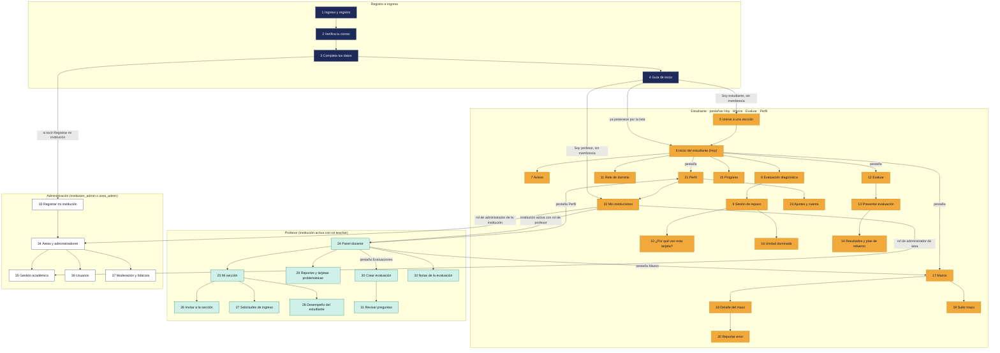

# Mapa de navegación

Imagen: `docs/diagramas_navegacion/navegacion.png` (también en SVG). Los números son los de `04_pantallas.md`.

## Arranque

| Situación | Pantalla inicial |
|---|---|
| Sin sesión | Ingreso (1) |
| Sesión con correo sin verificar | Verifica tu correo (2) |
| Correo verificado sin datos personales | Completa tus datos (3) |
| Sin ninguna membresía activa | Unirse a una sección (5) o Mis instituciones (22), según la elección guardada en el teléfono (por defecto 5, con enlace a 22) |
| Institución activa con rol de estudiante | Inicio del estudiante (6) |
| Institución activa con rol de profesor | Panel docente (24) |
| Institución activa con rol de administrador de la institución | Áreas y administradores (34) |
| Institución activa con rol de administrador de área | Gestión académica (35), filtrada a su área |
| Superadministrador de la plataforma | No usa la aplicación móvil: trabaja desde una herramienta interna del servidor (CU-36) |

Si una persona tiene varios roles en la misma institución (por ejemplo, profesora y administradora), arranca en
el de mayor alcance y cambia de vista desde Mis instituciones (22).

## Barras de navegación

- **Estudiante:** Hoy (6) · Mazos (17) · Evaluar (12) · Perfil (21).
- **Profesor:** Resumen (24) · Mazos (17, con la opción Asignar a una sección en Detalle del mazo, CU-08) ·
  Evaluaciones (30 Crear evaluación y 32 Notas) · Perfil (21).
- **Administrador:** Áreas (34, solo de la institución) · Gestión académica (35) · Usuarios (36, solo de la
  institución) · Moderación (37, solo de la institución) · Perfil (21).
- Desde Perfil (21) todos llegan a Mis instituciones (22) y Ajustes (23).

## Otras reglas

- **Registrar una institución:** 1 → 2 → 3 → 33. La institución exige una cuenta verificada (`created_by`).
- **Editar un mazo (CU-22):** Detalle del mazo (18) → Editar abre Subir mazo (19) con los datos cargados.
- **Avisos (7):** cada aviso abre la pantalla de su campo `notification.link` (por ejemplo, una solicitud de ingreso
  abre Solicitudes de ingreso (27)).
- **Sin conexión:** todo lo del estudiante funciona salvo el registro, unirse a una sección o institución, publicar
  mazos y descargar mazos nuevos.

